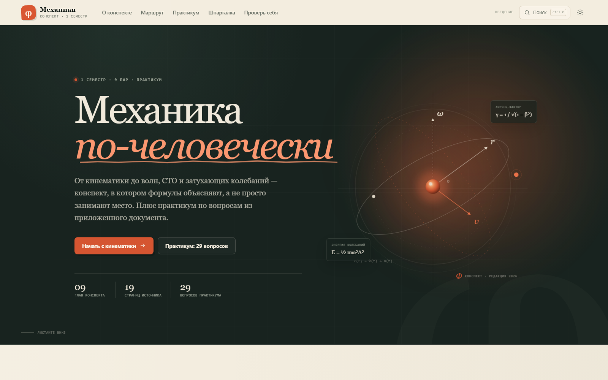

# Механика по-человечески

**Опубликованная версия:** [samuelglist.github.io/mechanics-notes](https://samuelglist.github.io/mechanics-notes/)

Сайт-конспект по механике, собранный по PDF из 19 страниц, плюс практикум по приложенному документу с вопросами. Это не дамп текста и не учебник: девять глав с маршрутом чтения, формулами, схемами и заметками на полях — и отдельный разбор 29 вопросов по шести темам.



## Быстрый запуск

Сайт полностью статический. Можно просто открыть `index.html` двойным щелчком — проверено в Chrome, включая формулы и локальные шрифты KaTeX.

Если хочется локальный адрес:

```powershell
cd D:\physix\mechanics-notes
node scripts/serve.mjs 4175
# http://127.0.0.1:4175/
```

Или через npm:

```powershell
npm start
```

## Что внутри

- **9 глав**: кинематика, векторы и повороты, Ньютон и энергия, момент инерции, гироскоп, СТО, преобразования Лоренца, релятивистская динамика, колебания.
- **Практикум по 29 вопросам** из приложенного документа: 6 тем, короткие ответы, расчёты и ссылки на теорию; фильтры по темам.
- **Теория волн и акустики**: плоская и сферическая волны, длина волны, интенсивность, эффект Доплера — тема, которой не было в исходном конспекте.
- **80+ формул** KaTeX — локальная сборка, без CDN и без интернета.
- **Интерактивная Лоренц-лаборатория**: ползунок β, γ, замедление времени и сокращение длины.
- **Осциллограф затухания**: график `x(t)`, огибающая, регулировка γ и ω₀, пауза.
- **Поиск** по главам, практике и шпаргалке: `Ctrl+K` или `/`.
- **Тёмная тема** и запоминание выбора.
- **Проверь себя**: 5 вопросов с разбором.
- **Шпаргалка** с фильтрами по темам и копированием формул в LaTeX.
- **Оригиналы**: 19 страниц конспекта и PDF с вопросами доступны для просмотра и скачивания.

## Структура

```text
mechanics-notes/
├─ index.html              весь контент и разметка
├─ styles.css              дизайн, адаптив, тёмная тема, печать
├─ app.js                  поиск, темы, калькулятор, график, квиз, практикум, просмотрщик
├─ assets/
│  ├─ pages/               19 страниц оригинала в WebP
│  └─ source/
│     ├─ book.pdf           исходный конспект
│     └─ questions.pdf      документ с 29 вопросами
├─ vendor/katex/           локальный KaTeX и шрифты
└─ scripts/
   ├─ serve.mjs            статический сервер без зависимостей
   └─ check.mjs            проверка в headless Chrome
```

## Проверка

```powershell
node scripts/check.mjs http://127.0.0.1:4175/
```

Скрипт проверяет количество глав, формулы, ошибки KaTeX, горизонтальное переполнение, поиск, практикум, фильтры, калькулятор, квиз и просмотр страниц. Скриншоты проверки сохраняются в `.shots/`.

## Редакторская политика

Структура, порядок тем и интонация — из исходного конспекта. При этом:

- исправлены очевидные опечатки в формулах;
- спорные места отмечены плашкой **«Сверено»**;
- в СТО выбрано стандартное соглашение о знаках, а отличие от записи в тетради объяснено;
- формулы для поперечных компонент скорости приведены к корректному виду;
- для математического маятника использовано корректное уравнение после подстановки `I = mb²`;
- в практикуме отдельно отмечены три уточнения к ответам исходного документа (зависимость `aₙ` от радиуса, постоянство `L`, различие относительной скорости и темпа сближения).

Оригиналы не изменялись: `assets/source/book.pdf` и `assets/source/questions.pdf`.

## Правки

Контент — в `index.html`, оформление — в `styles.css`, поведение — в `app.js`. Формулы записаны как `$$...$$` и рендерятся при загрузке. Для новой страницы оригинала положите WebP в `assets/pages/` и добавьте кнопку с `data-page`.
